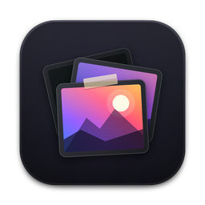
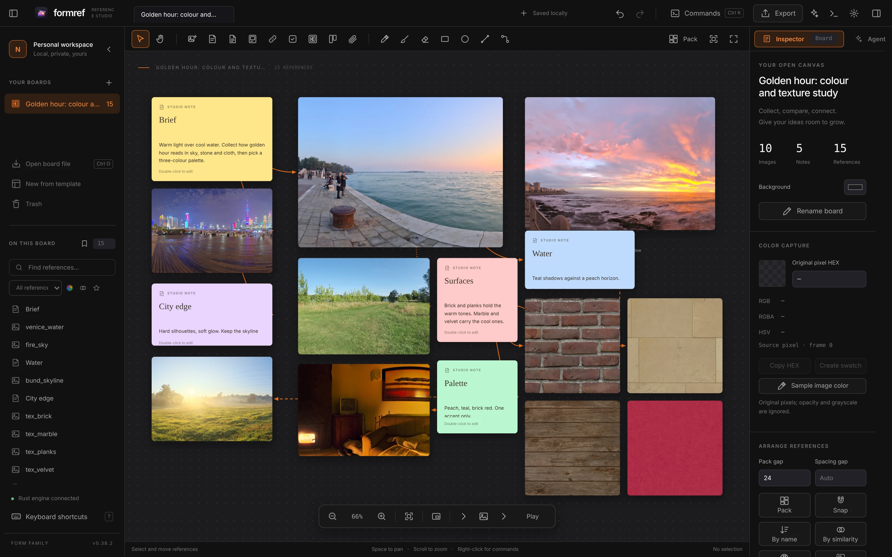
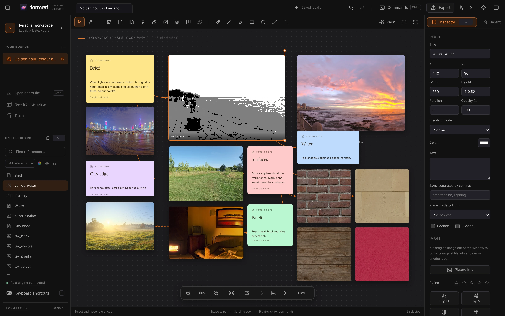
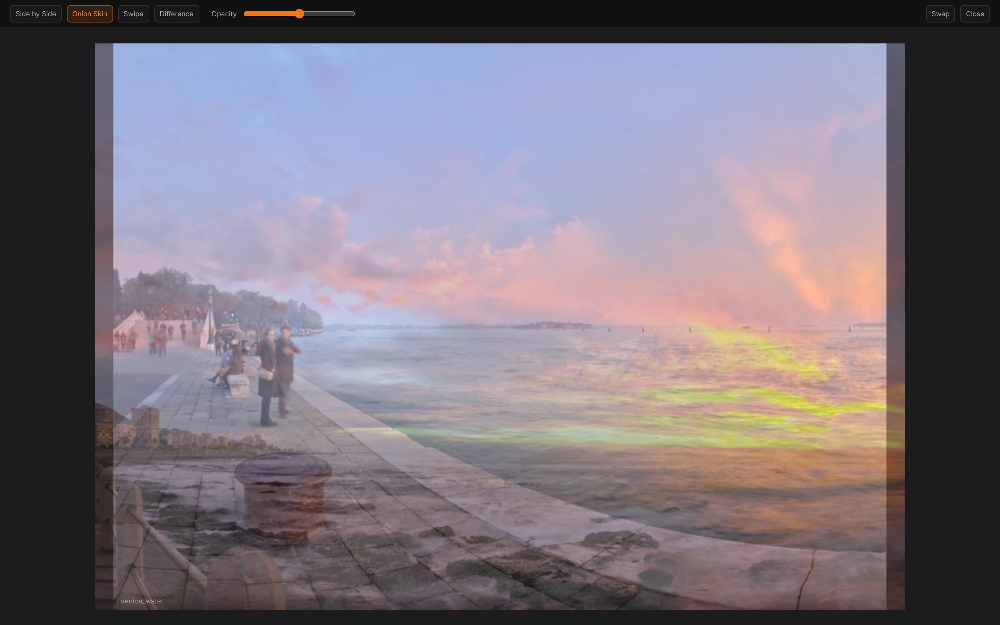
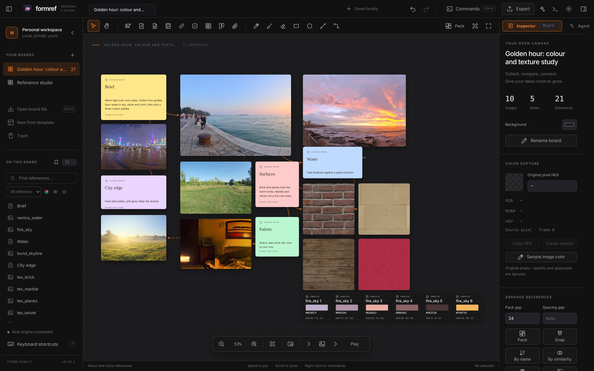

<p align="center">
  
</p>

<h1 align="center">FormRef</h1>

<p align="center">
  <b>Reference boards; the moodboard and study table of the Form family.</b><br>
  Images, notes, tasks and links on a free canvas, with study aids,<br>
  an embedded agent and MCP. Local, no account, and yours.
</p>

<p align="center">
  
  
  
  
  
  
</p>

<p align="center">
  <a href="https://formref.formai.studio/"><b>Download FormRef on formai.studio</b></a> ·
  <a href="#run-it-from-source">Run it from source</a>
</p>

<br>

<p align="center">
  
  <br>
  <sub>A reference board: CC0 photo crops and textures on the free canvas, with notes and links between ideas.</sub>
</p>

<p align="center">
  <a href="#features">Features</a> ·
  <a href="#everything-in-the-box">In the box</a> ·
  <a href="#built-for-agents">Agents</a> ·
  <a href="#under-the-hood">Under the hood</a> ·
  <a href="#download">Download</a> ·
  <a href="#run-it-from-source">Run from source</a>
</p>

<br>

<table>
  <tr>
    <td width="25%" valign="top"><h3>Free canvas</h3>Pictures, notes, tasks, tables, links and maps sit anywhere on an endless board, with grouping, columns and nested boards.</td>
    <td width="25%" valign="top"><h3>Study aids</h3>Value Study, a drawing grid, palette extraction, measuring, comparing and timed practice sessions for drawing from reference.</td>
    <td width="25%" valign="top"><h3>Local-first</h3>Boards and original files are saved on your computer. The service listens on this machine only, and no account is needed.</td>
    <td width="25%" valign="top"><h3>Agent-ready</h3>The same board engine is reachable from the window, an embedded agent panel and an MCP server on stdio or HTTP.</td>
  </tr>
</table>

<br>

## Features

<table>
  <tr>
    <td width="50%" valign="top">
      <br><sub>Value Study reduces a photograph to 2 to 8 grey values.</sub>
      <h3>See the values</h3>Notan at 2 values, up to 8 greys, and a self-inverting Drawing Grid. Brightness, contrast and saturation changes carry into exports.
    </td>
    <td width="50%" valign="top">
      <br><sub>Compare two pictures as an onion skin, with a swipe divider or as a difference.</sub>
      <h3>Compare pictures</h3>Select two pictures and press Alt+C. Side by side, onion skin, swipe or difference, with Swap to switch the two.
    </td>
  </tr>
  <tr>
    <td width="50%" valign="top">
      <br><sub>Extract Palette adds the picture's main colours as swatches, most used first.</sub>
      <h3>Pull a palette</h3>Swatches are real board items with hex and RGB values, so they can be edited, connected and exported with the board.
    </td>
    <td width="50%" valign="top">
      <h3>Connect ideas</h3>Lines between items can be solid, dashed or dotted, with arrowheads, a label and a curved, straight or elbow route. Groups connect like single items.
      <h3>Practice from reference</h3>Timed Practice (Alt+T) shows pictures one at a time for gesture and figure drawing, shuffled, with pause, mirror, grey and a log of every session.
      <h3>Start from Home</h3>Home lists your boards and templates and opens three demo boards and a starter board as new boards of your own. A menubar (the macOS menu bar on a Mac) holds every command, and Preferences is one window with a category rail.
    </td>
  </tr>
</table>

## Everything in the box

<table>
  <tr>
    <td width="33%" valign="top"><h4>Item kinds</h4>Pictures · Notes · Documents · Tasks · Tables · Links · Maps · Columns · Video and audio · Swatches · Nested boards</td>
    <td width="33%" valign="top"><h4>26 languages</h4>English · Spanish · Portuguese · French · German · Italian · Dutch · Nordic · Russian · Polish · Czech · Hungarian · Ukrainian · Turkish · Chinese · Japanese · Korean · Indonesian · Thai · Vietnamese</td>
    <td width="33%" valign="top"><h4>Formats</h4>Opens: images, GIF, PDF pages, video, audio, BeeRef <code>.bee</code> boards · Saves: PNG, SVG, PDF, Markdown, JSON, portable archive, ZIP of originals</td>
  </tr>
</table>

## Built for agents

47 MCP tools drive the same Rust engine that the window uses; `./formref open` and `./formref import` work with the running app.

```sh
./formref import ./moodboard --title "Golden hour" --recursive   # a folder of pictures becomes a board
./formref open "Golden hour"                                     # show a board in the window
./formref mcp                                                    # MCP server on stdio for Claude Code, Codex and Cursor
```

`.mcp.json`, `.codex/config.toml` and `.cursor/mcp.json` are already wired in this repo, and the server also answers on `http://127.0.0.1:8320/mcp`. Outside agents are refused until you allow them in the Agent panel, and the commands above count as one: with the choice at its default, `./formref import` and `./formref open` stop with `outside_agents_off`, so allow outside agents in FormRef first (the window asks the first time one is refused). Only the FormRef window can change that choice. See [`AGENTS.md`](AGENTS.md).

## Under the hood

- **Rust engine:** `native/formref-core` owns geometry, locking, grouping, arrangement and undo and redo for every board.
- **Python service:** FastAPI handles assets, imports and exports, persistence and the MCP server on 127.0.0.1:8320.
- **Vanilla TypeScript:** a Vite view with stable keyed DOM, the Form family dark tokens and inline icons.
- **Desktop shell:** Tauri 2 packages the app with its own frozen engine, so nothing else needs to run.
- **Embedded agent:** a panel that runs Claude Code, Codex, Cursor or Ollama on your board and asks before it removes or bulk-moves items.

## Download

| Platform | Download | Release |
|---|---|---|
| macOS | [Download FormRef for macOS](https://formai.studio/get/formref/macos) | [FormRef releases on FormCompiler](https://github.com/nodemode-dev/formcompiler/releases?q=formref-v&expanded=true) |
| Windows | [Download FormRef for Windows](https://formai.studio/get/formref/windows) | [FormRef releases on FormCompiler](https://github.com/nodemode-dev/formcompiler/releases?q=formref-v&expanded=true) |
| Linux | [Download FormRef for Linux](https://formai.studio/get/formref/linux) | [FormRef releases on FormCompiler](https://github.com/nodemode-dev/formcompiler/releases?q=formref-v&expanded=true) |

All FormRef builds are compiled and released from [FormCompiler](https://github.com/nodemode-dev/formcompiler); this repo holds the source.

## Run it from source

Prefer it in your browser, or want to contribute? Run the web UI straight from this repo.

**Requires:** Node 20.19 or 22.12+, Python 3.12+ and Rust 1.82+. The desktop shell needs Rust 1.90+ and the [Tauri prerequisites](https://v2.tauri.app/start/prerequisites/).

```sh
git clone git@github.com:nodemode-dev/formref.git
cd formref
./formref install     # Rust core, backend venv and frontend packages
./formref             # service on 127.0.0.1:8320, web UI at http://localhost:5320
```

`./formref desktop` opens the desktop window instead, and `./build_app` builds the installable app (add `--web` to stop after the web build).

On Windows use `formref_oc_install.bat` then `formref.bat`. The editor is on http://localhost:5320, the service and its API docs (`/docs`) on 127.0.0.1:8320, both loopback only. `FORMREF_DATA_DIR` overrides the board and asset folder, and `FORMREF_PYTHON` and `FORMREF_ENGINE_PATH` override the Python and Rust executables.

> [!IMPORTANT]
> **Status:** in development. Real-time collaboration and protected sharing are not built, the browser clipper loads unpacked, and the packaged builds have not yet been run on every OS. Only Claude Code has been run end to end in the Agent panel.

**Contributing:** branch from `main`, keep changes to source here, and leave packaging and releases to formcompiler. See [`CONTRIBUTING.md`](CONTRIBUTING.md), [`CODE_OF_CONDUCT.md`](CODE_OF_CONDUCT.md), [`CLAUDE.md`](CLAUDE.md), [`AGENTS.md`](AGENTS.md) and the [release conventions](.docs/wiki/Releases.md). Report security issues privately as [`SECURITY.md`](SECURITY.md) describes.

## Repository

`frontend/` is the editor view, `backend/app/` the service (HTTP, assets, persistence, MCP), `native/formref-core/` the Rust board engine, `src-tauri/` the desktop shell and installers, and `clipper/` the browser clipper for Chrome and Firefox.

Docs: [`.docs/wiki`](.docs/wiki) · Agents: [`CLAUDE.md`](CLAUDE.md), [`AGENTS.md`](AGENTS.md)

## Maintainers

| Maintainer | Role |
|---|---|
| [@nodemode-ai](https://github.com/nodemode-ai) | Owner |
| [@gbarnai](https://github.com/gbarnai) | Co-owner |

Code owners are set in [`.github/CODEOWNERS`](.github/CODEOWNERS).

## License

FormRef is licensed under the Apache License 2.0 ([`LICENSE`](LICENSE), SPDX `Apache-2.0`). Copyright 2026 NodeAgentc, Inc. Third-party notices: [`NOTICE.md`](NOTICE.md).

<sub>Screenshot content: CC0 photos and textures from Poly Haven, and original sample notes.</sub>

<sub>PureRef, Milanote, BeeRef and Illustrator are trademarks of their respective owners (Illustrator of Adobe in the United States and/or other countries). FormRef is not affiliated with or endorsed by any of them; they are named only for file compatibility and in the notices on how their public documentation was studied.</sub>
